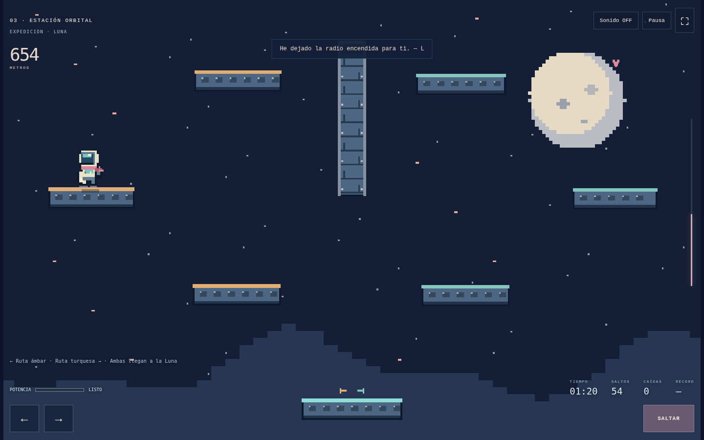
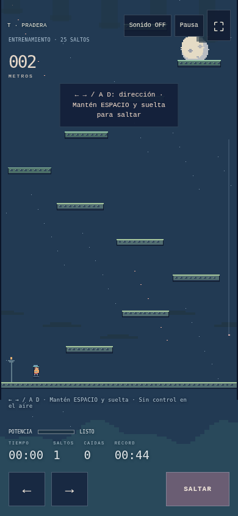

<div align="center">


# HASTA LA LUNA

**Una promesa. Un astronauta. Ningún salto de vuelta.**

*Ella mira la Tierra cada noche. Tú solo necesitas seguir subiendo.*

### [🚀 JUGAR AHORA](https://a-perfectstranger.github.io/arcos-eduardo-jueg-gr3/mi-primer-juego/)

[](https://github.com/A-PerfectStranger/arcos-eduardo-jueg-gr3/actions/workflows/verify.yml)
[](https://github.com/A-PerfectStranger/arcos-eduardo-jueg-gr3/actions/workflows/production.yml)

**5 zonas ampliadas** · **120 saltos por ruta** · **Sin checkpoints** · **Un mundo por semilla**

[Misión](#tu-misión) · [Controles](#antes-de-despegar) · [Transmisiones](#abre-una-transmisión) · [Reto LUNA](#una-semilla-dos-astronautas) · [Hangar técnico](#hangar-técnico)

[](https://a-perfectstranger.github.io/arcos-eduardo-jueg-gr3/mi-primer-juego/)

<sub>Captura real del juego. Pulsa la imagen para comenzar tu viaje.</sub>

</div>

---

## Tu misión

Todo está dibujado con píxeles grandes: personajes nativos de **16 × 24**, fondos escalonados y plataformas cuya superficie visible coincide con la colisión.

La radio apenas atraviesa la atmósfera. Entre el ruido, reconoces su voz:

> «Guardé un sitio para ti en la Luna.» — L

No tienes un cohete que te lleve hasta ella. Tienes tus botas, una dirección y la paciencia para volver a intentarlo.

**Carga. Apunta. Suelta.** En cuanto despegas, el salto ya está decidido. Si fallas, caerás sobre el mundo que acabas de escalar. A veces, muy lejos.

| Etapa | Objetivo | Lo que te espera |
| --- | --- | --- |
| **00 · Entrenamiento** | Completa el mapa original de 25 plataformas | Practica con el cadete, sin traje espacial; aprende carga, rebotes y caídas |
| **01 · Expedición** | Recorre cinco zonas y 30 tramos con dos rutas | Elige ruta ámbar o turquesa; ambas llevan a la Luna |
| **02 · Reencuentro** | Aterriza junto a ella en la Luna | El final de esta promesa; otra semilla para tu próxima aventura |

Cada zona de campaña contiene **seis tramos de cuatro ascensos**: 24 saltos por zona, tres veces la extensión de la versión anterior. Hay **210 plataformas elevadas**, suelo y **15 paredes sólidas** repartidas por el viaje. Cada tramo permite subir por la ruta ámbar o por la turquesa y reunirse al final; puedes cambiar de ruta en esos encuentros.

Completar el entrenamiento desbloquea **Partir hacia la Luna**. Entonces el cadete se equipa con el traje de astronauta. El navegador recuerda ese desbloqueo. Después puedes repetirlo o elegir **Nueva expedición** desde el menú.

## Antes de despegar

| Acción | Teclado | Pantalla táctil |
| --- | --- | --- |
| Caminar y elegir dirección | **← / →** o **A / D** | Flechas laterales |
| Preparar el salto | Mantén **Espacio** | Mantén **SALTAR** |
| Saltar | Suelta **Espacio** con la dirección elegida | Suelta **SALTAR** con una flecha pulsada |
| Saltar en vertical | Suelta sin pulsar dirección | Suelta sin pulsar flechas |
| Tomar un respiro | **Esc** | **Pausa** |
| Empezar de nuevo | **R**, con confirmación | Pausa → Volver al inicio |
| Sonido | **M** | **Sonido ON / OFF** |
| Pantalla completa | Botón **⛶** | Botón **⛶**, si lo admite el navegador |

**Tres reglas que se aprenden con los pies:**

1. Mientras cargas, dejas de caminar. Tu posición de despegue importa.
2. No puedes corregir la trayectoria en el aire. Las paredes te hacen rebotar; los techos frenan la subida.
3. Cargar al máximo no siempre ayuda. Los saltos medidos pueden pedirte que sueltes antes.

<details>
<summary><strong>📡 ¿Puedo cerrar la página sin perder el viaje?</strong></summary>

Sí. El ascenso se guarda aproximadamente cada segundo y al pausar o salir. **Continuar viaje** recupera posición, velocidad, semilla y estadísticas, incluso durante una caída. No te devuelve a una plataforma segura.

**Compatibilidad de partidas:** el mapa de campaña cambió en esta revisión, así que los ascensos y récords anteriores no se mezclan con los nuevos. El desbloqueo del entrenamiento se conserva.

El tiempo excluye pausas y periodos con la pestaña oculta. El récord de entrenamiento se guarda por separado; cada semilla de campaña tiene su propio récord. Si el navegador bloquea el almacenamiento, puedes jugar durante la sesión, pero no conservar el progreso al cerrarla.

</details>

<details>
<summary><strong>🛰️ ¿Puedo preparar el siguiente salto antes de aterrizar?</strong></summary>

Puedes mantener Espacio justo antes de aterrizar: la carga empieza al tocar suelo, sin contar el tiempo en el aire. Después de caminar sobre la plataforma puedes cargar y elegir dirección con normalidad. Incluso una pulsación breve entre dos pasos de la simulación se conserva.

Soltar sigue siendo lo que dispara el salto. Mantener el botón no provoca un salto automático.

</details>

<details>
<summary><strong>📱 Abre la vista desde un dispositivo móvil</strong></summary>

<div align="center">

</div>

Los botones admiten dirección y salto simultáneos. Gira la pantalla si prefieres una vista más ancha. La compatibilidad se ha comprobado en Chromium con emulación táctil; quedan pendientes pruebas en teléfonos físicos.

</details>

## Abre una transmisión

Cinco zonas separan la Tierra de su ventana. **Pulsa cada transmisión** para leer su mensaje y preparar el siguiente tramo.

| Señal | Destino | Anchura de apoyo lateral | Exigencia de precisión |
| --- | --- | --- | --- |
| 01 | Cosmódromo | 152–158 px | ★☆☆☆☆ |
| 02 | Estratosfera | 124–130 px | ★★☆☆☆ |
| 03 | Estación orbital | 96–102 px | ★★★☆☆ |
| 04 | Campo de asteroides | 68–74 px | ★★★★☆ |
| 05 | Luna | 40–46 px | ★★★★★ |

<details>
<summary><strong>01 · COSMÓDROMO — La última noche en casa</strong></summary>

> «Veo tu luz desde aquí. Sigue subiendo.» — L

La Tierra todavía parece cercana. Elige la señal ámbar a la izquierda o la turquesa a la derecha. Ambas rutas se encuentran al terminar el tramo. Usa los apoyos anchos para encontrar tu ritmo; no hay prisa por soltar.

</details>

<details>
<summary><strong>02 · ESTRATOSFERA — Donde termina el cielo</strong></summary>

> «Las nubes parecen un océano entre nosotros.» — L

Las nubes se apartan; los bordes se acercan. Las plataformas se estrechan y las subidas crecen. Mira el destino antes de cargar: una nube no detendrá tu caída.

</details>

<details>
<summary><strong>03 · ESTACIÓN ORBITAL — Cartas en órbita</strong></summary>

> «He dejado la radio encendida para ti.» — L

Entre paneles orbitales, los muros dividen algunos tramos. Son sólidos: bloquean la subida por el centro y permiten rebotar contra sus laterales o aterrizar sobre su borde. Alterna impulso y medida; más potencia puede llevarte más allá del destino.

</details>

<details>
<summary><strong>04 · ASTEROIDES — El silencio entre estrellas</strong></summary>

> «No oigo tus pasos, pero sé que estás cerca.» — L

Los apoyos son más pequeños. Revisa la posición de tus botas y la distancia al siguiente borde. Si caes, el camino anterior sigue ahí; tendrás que volver a ganarte la altura.

</details>

<details>
<summary><strong>05 · LUNA — A un salto de ti</strong></summary>

La señal ya casi no tiene ruido. Los apoyos laterales tienen entre **40 y 46 píxeles** de ancho; las plataformas de encuentro miden 58 px. Combina lo aprendido: posición, dirección y carga. El último tramo pide precisión.

El mensaje final te espera dentro del juego.

</details>

## Una semilla, dos astronautas

¿Quieres competir en el mismo mundo? Comparte una semilla.

1. Completa el entrenamiento y vuelve al menú.
2. Escribe **`LUNA`** en **SEMILLA DE EXPEDICIÓN**.
3. Elige **Nueva expedición** y anota tu tiempo y tus caídas.
4. Invita a otra persona a usar exactamente la misma semilla.

**Reto de la radio:** llega a la Luna con menos caídas que en tu intento anterior. Si prefieres velocidad, compara tiempos en la misma semilla.

Una semilla reproduce la geometría del mapa. Reiniciar con **R** o elegir **Otra expedición** al terminar crea una semilla nueva. Para repetir un mundo concreto, vuelve a escribir su semilla en el menú.

> Cada intento cambia el viaje. Lo que aprendes se queda contigo.

---

## Hangar técnico

La bitácora también se abre desde dentro. Despliega la sección que necesites para ejecutar, estudiar o mejorar el juego.

<details>
<summary><strong>🔧 Encender el juego en tu equipo</strong></summary>

Desde la raíz del repositorio:

```sh
python3 -m http.server 8080
```

Abre **http://localhost:8080/mi-primer-juego/**. No requiere compilación ni dependencias de ejecución adicionales. Se necesita un servidor HTTP para cargar los módulos JavaScript. Phaser 3.90.0 dispone de respaldo local si falla el CDN.

</details>

<details>
<summary><strong>🧭 Estudio de Jump King, física, cámara y generación procedural</strong></summary>

La [descripción oficial de Nexile](https://www.jump-king.com/) establece la carga y liberación del salto, el compromiso en el aire, las caídas largas y el guardado del progreso. Se mantienen esos principios. Los valores siguientes son decisiones de este juego; **no son constantes verificadas del motor original de Jump King**.

La documentación del Workshop distingue [hitboxes](https://teamnexile.github.io/jk-workshop-docs/level-making/hitboxes/) y [capas visuales](https://teamnexile.github.io/jk-workshop-docs/level-making/screens/). Aquí la colisión usa rectángulos independientes del dibujo: bufanda, casco y decoración no cambian la hitbox. La guía de [diseño de niveles del Workshop](https://teamnexile.github.io/jk-workshop-docs/level-making/tips/) reúne consejos comunitarios para equilibrar rutas, variar retos y probar los niveles. Se usan como orientación, no como especificación interna del juego.

| Sistema | En esta revisión | Motivo |
| --- | --- | --- |
| Salto | Carga lineal de 0–800 ms; velocidad inicial vertical de 250–690 px/s; horizontal de 250 px/s al saltar hacia un lado | Carga aprendible y dirección comprometida |
| Física | Simulación propia a 120 Hz, gravedad de 1300 px/s² y caída limitada a 1100 px/s; Phaser dibuja | La misma entrada produce la misma trayectoria con 30, 60 o 144 FPS de renderizado |
| Colisiones | Barrido AABB continuo y apoyo real de los pies; se requieren 2 px de contacto con una suela de 12 px | Evitar el apoyo invisible fuera del borde; techos y paredes son sólidos, con rebote lateral al 70 % |
| Cámara | Franja de seguimiento, suavizado exponencial independiente del FPS, límites por mapa y margen para HUD/táctil | Ver destino y caída; evitar que la cámara oscile con cada pequeño salto |
| Niveles | 30 tramos, dos rutas por tramo, 15 paredes y validación de cada salto con pequeñas variaciones de posición | Ofrecer decisiones y garantizar que el despegue no dependa de una coordenada perfecta |
| Progresión | Plataformas cada vez más pequeñas y mezcla de cargas parciales y altas | Aumentar precisión sin cambiar la física aprendida |
| Presentación | Sprites de 16 × 24 px, escala 2 sin filtrado, paleta corta y poses con un único anclaje en los pies | Cadete en entrenamiento, astronauta en campaña y aspecto de consola antigua |

No se copia el mapa, las texturas ni el código de Jump King. La cámara de esta versión conserva seguimiento continuo; no pretende reproducir exactamente la composición por pantallas del original.

### Parámetros del generador

| Zona | Anchura de plataforma | Subida habitual | Subida de carga parcial |
| --- | --- | --- | --- |
| Cosmódromo | 152–158 px | 112–120 px | — |
| Estratosfera | 124–130 px | 120–130 px | — |
| Estación orbital | 96–102 px | 126–140 px | 104–116 px |
| Asteroides | 68–74 px | 134–148 px | 98–110 px |
| Luna | 40–46 px | 140–154 px | 92–104 px |

La tabla describe los apoyos de las rutas. Las plataformas de encuentro tienen 12 px más de anchura. La separación vertical se varía unos pocos píxeles por ruta; los rangos de la tabla son las alturas base de cada tramo. Todas las plataformas de una zona siguen siendo más estrechas que las de la anterior.

El generador construye **seis tramos por zona**, cada uno con una entrada, tres apoyos ámbar, tres turquesa y una salida común. Los recorridos convergen sin actuar como checkpoints: las caídas siguen siendo continuas. En tramos alternos aparece un muro central; el espacio inferior permite salir hacia cualquiera de las rutas.

Una vez colocados **todos los sólidos**, el planificador busca cargas y posiciones de despegue con la clase `Astronaut`, la misma que usa el jugador. Cada conexión se prueba desde la posición elegida y desde **±1,5 px**, más de un paso de caminata de la simulación. Así evita recorridos que solo funcionarían desde un punto subpíxel exacto. Hay dos planes completos de 120 saltos y se pueden mezclar en los encuentros. El mapa no se regenera durante una caída.

Los pies usan un apoyo de 12 px, centrado bajo el personaje, con al menos 2 px de contacto. Salir de ese apoyo inicia la caída; el rectángulo del cuerpo no mantiene al personaje flotando fuera del borde. Las poses no cambian sus dimensiones ni su punto de contacto.

La entrada conserva pulsaciones breves entre ticks y permite empezar a cargar al aterrizar con el botón mantenido. La carga no se acumula en el aire. Teclado y pulsadores táctiles mantienen estados independientes, de modo que soltar uno no cancela el otro.

La garantía es que existen rutas comprobadas, no que cualquier salto permita recuperar la siguiente plataforma. La dificultad humana requiere pruebas de juego. No se añade control aéreo ni cambios de gravedad por zona. Para afinar el juego, modifica `WORLD`, `ROOMS_PER_ZONE` o `CAMPAIGN_ZONES` y vuelve a ejecutar las pruebas.


</details>

<details>
<summary><strong>🎨 Código, atlas de sprites y arte espacial</strong></summary>

- `mi-primer-juego/src/model.js`: física pura, almacenamiento, mapa de entrenamiento y generador.
- `mi-primer-juego/src/game.js`: presentación, cámara, estados, entrada, audio y guardado de la partida.
- `mi-primer-juego/src/sprites.js`: dibujos originales sobre una cuadrícula de 16 × 24 px, con pies alineados en la fila 23. Cadete, astronauta y amada tienen ocho poses cada uno; el reencuentro combina dos sprites. La hitbox del cuerpo sigue siendo de 22 × 42 px.
- [`retro-sprites.png`](mi-primer-juego/assets/retro-sprites.png): atlas exportado de **128 × 72 px**, con cadete, astronauta y amada en filas. El código dibuja estos mismos píxeles, sin recortes automáticos ni filtrado.
- `mi-primer-juego/assets/retro-cover.png`: nueva ilustración de portada de inspiración retro, generada para esta temática. Los personajes del juego se dibujan sobre su cuadrícula nativa, no se recortan de la portada.

- `mi-primer-juego/assets/moon.svg`: icono lunar. `mi-primer-juego/assets/crown.svg` se conserva como archivo legado sin uso.

Los fondos y plataformas se dibujan por código con paletas, paneles orbitales, asteroides y superficie lunar. Phaser conserva su [licencia MIT](mi-primer-juego/assets/vendor/PHASER-LICENSE.md). El PDF anterior es material histórico y no describe esta versión.


Las capturas de esta bitácora están en `mi-primer-juego/assets/readme/` y proceden de recorridos reales de las pruebas de navegador.

</details>

<details>
<summary><strong>🧪 Sala de pruebas y publicación en GitHub Pages</strong></summary>

```sh
npm --prefix mi-primer-juego test
pip install -r mi-primer-juego/tests/requirements.txt
python -m playwright install --with-deps chromium
# Con el servidor HTTP activo:
CHROMIUM_PATH=/ruta/a/chromium python3 mi-primer-juego/tests/browser.py
```

El modelo prueba **1.000 semillas y 240.000 conexiones de salto**, cada una con margen de posición, además de recorridos continuos por la izquierda, la derecha y combinando ambas rutas. Cubre el entrenamiento, bordes sin apoyo, carga al aterrizar, paredes, techos y colisiones de alta velocidad. Chromium realiza **29 comprobaciones**, incluidos los 120 saltos de cada ruta completa, caminar y volver a saltar, pulsaciones breves y teclado combinado con táctil. Los recorridos completos usan entradas y simulación real, sin recolocar al astronauta.

`?qa=1` expone la escena para pruebas. `CIMA_TEST_OUTPUT` elige la carpeta de evidencias; `CIMA_URL` permite probar otra URL terminada en `/`.

**Cómo llega la misión a la web:**

- `main / (root)` es la fuente de GitHub Pages; el HTML raíz dirige a `mi-primer-juego/`.
- **Verify CIMA** comprueba el modelo y juega la versión del repositorio en Chromium.
- **Verify published CIMA** espera a que los archivos públicos coincidan por SHA-256 con el código del commit y después juega la versión publicada.
- Las capturas y resultados quedan en los artefactos de [GitHub Actions](https://github.com/A-PerfectStranger/arcos-eduardo-jueg-gr3/actions). Los indicadores de la cabecera enlazan a cada verificación.

Las pruebas realizadas cubren Chromium de escritorio y emulación táctil. Faltan Safari, Firefox, teléfonos físicos y sesiones con personas para afinar el ritmo. Las plataformas y paredes son estáticas; la variedad procede de las rutas, las posiciones, las alturas y las decisiones en cada encuentro. Futuros obstáculos móviles requieren una validación específica antes de incorporarse.

</details>

---

<div align="center">

**El cielo no es el final del camino.**

### [Dar el primer salto →](https://a-perfectstranger.github.io/arcos-eduardo-jueg-gr3/mi-primer-juego/)

<sub>Hasta la Luna · CIMA — aventura de precisión inspirada en Jump King.</sub>

</div>
